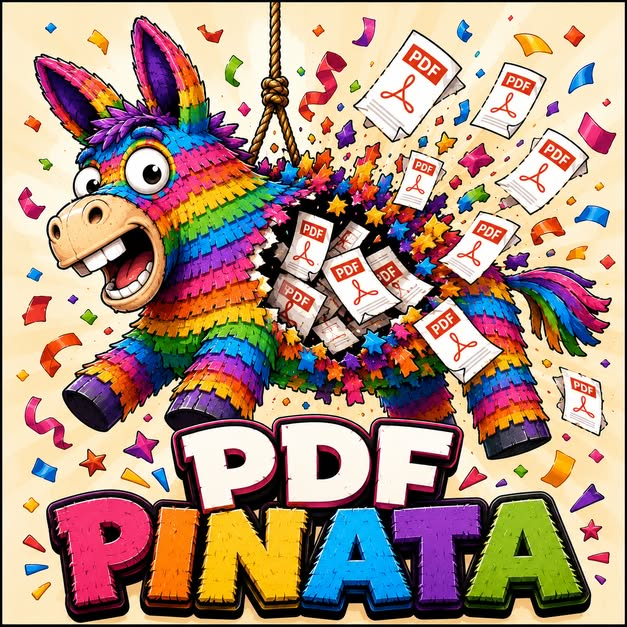

<p align="center">
  
</p>

# PdfPinata

**PdfPinata is a .NET library for creating, drawing, and manipulating PDF documents.**

It provides a PDF document model and drawing API for working with pages, text, fonts, images, shapes, and existing PDF files. It can be used directly for low-level PDF drawing, or together with **PinataLayout** for higher-level document layouts such as paragraphs, tables, headers, footers, and flowing content.

Typical uses include:

* generating invoices, reports, statements, and other PDFs
* drawing text, images, lines, shapes, and graphics onto pages
* loading and modifying existing PDF documents
* embedding and subsetting fonts
* rendering multilingual and right-to-left text
* building reusable document layouts with PinataLayout
* generating PDFs on Windows, Linux, macOS, and Unity

PdfPinata forked [PdfSharpCore](https://github.com/ststeiger/PdfSharpCore), The fork continues that API while separating font and image handling into interchangeable backends and extending text support among other enhancements.

The core `PdfPinata` package has no imaging or font-rendering dependency of its own. Choose a backend package and register it once when your application starts.

**[Documentation](https://pinatalabs.github.io/PdfPinata):**  has installation steps, a getting-started guide, a page for each feature, and a gallery of every demo with the PDF it makes.

## Badges

[](https://www.nuget.org/packages/PdfPinata/)
[](https://pinatalabs.github.io/PdfPinata/)
[](https://github.com/PinataLabs/PdfPinata/actions/workflows/build-and-test.yml)
[](https://codecov.io/gh/PinataLabs/PdfPinata)
[](https://sonarcloud.io/summary/new_code?id=PinataLabs_PdfPinata)


## Packages

### Rendering backends

| Package                 | Backend                                                                                                                   | License                  | Notes                                                                                                                                  |
| ----------------------- | ------------------------------------------------------------------------------------------------------------------------- | ------------------------ | -------------------------------------------------------------------------------------------------------------------------------------- |
| `PdfPinata.Skia`        | [SkiaSharp](https://github.com/mono/SkiaSharp)                                                                            | MIT                      | Recommended backend. Requires native assets for the target platform.                                                                   |
| `PdfPinata.ImageSharp4` | [SixLabors.ImageSharp](https://github.com/SixLabors/ImageSharp) 4.x / [Fonts](https://github.com/SixLabors/Fonts) 3.x     | Six Labors Split License | Fully managed. The ImageSharp backend to choose, unless you target Unity or need Apache-2.0 dependencies. `net8.0` and `net10.0` only. |
| `PdfPinata.ImageSharp`  | [SixLabors.ImageSharp](https://github.com/SixLabors/ImageSharp) 2.1.x / [Fonts](https://github.com/SixLabors/Fonts) 1.0.1 | Apache-2.0               | Fully managed. For Unity and Apache-2.0 only. ImageSharp 2.1.x is end of life, with five security advisories that will never be fixed. |

The two ImageSharp packages have the same types in the same namespaces, so switching between them is a change to the project file only. See [ImageSharp packages](#imagesharp-packages).

Register the backend before creating fonts or loading images:

```csharp
using PinataLayout.DocumentObjectModel.Shapes;
using PdfPinata.Fonts;
using PdfPinata.Skia;
using PdfPinata.Utils;

GlobalFontSettings.FontResolver = new SkiaFontResolver();
ImageSource.ImageSourceImpl = new SkiaImageSource();
```

If a font or image API is used before its backend has been registered, PdfPinata throws a `InvalidOperationException`.

### Text shaping

Complex text shaping is available through the optional `PdfPinata.HarfBuzz` package.

| Package              | Backend                                            | License | Notes                                                                  |
| -------------------- | -------------------------------------------------- | ------- | ---------------------------------------------------------------------- |
| `PdfPinata.HarfBuzz` | [HarfBuzzSharp](https://github.com/mono/SkiaSharp) | MIT     | Optional. Works with either rendering backend. Requires native assets. |

Without HarfBuzz, PdfPinata maps Unicode characters directly to glyphs using the font's `cmap`. This is sufficient for basic Latin text, but does not provide features such as kerning, ligatures, or contextual Arabic letter forms.

Registering HarfBuzz enables the font's OpenType `GSUB` and `GPOS` shaping rules:

```csharp
using PdfPinata.Fonts;
using PdfPinata.HarfBuzz;

GlobalFontSettings.TextShaper = new HarfBuzzTextShaper();
```

Text shaping affects measured text width and therefore can change line wrapping. Register it before creating layouts whose output needs to remain stable.

HarfBuzz is kept separate from the rendering backend so shaping can be used with either SkiaSharp or ImageSharp.

Applications must reference the appropriate native assets:

```xml
<PackageReference Include="HarfBuzzSharp.NativeAssets.Win32" Version="14.2.1.2" />
<PackageReference Include="HarfBuzzSharp.NativeAssets.Linux" Version="14.2.1.2" />
<PackageReference Include="HarfBuzzSharp.NativeAssets.macOS" Version="14.2.1.2" />
```

## International text

### Bidirectional text

Unicode bidirectional text handling is built into PdfPinata and does **not** require HarfBuzz.

`DrawString` and `MeasureString` apply the Unicode Bidirectional Algorithm, separating text into directional and script runs before measuring or drawing them.

This means right-to-left text is presented in reading order even when text shaping is not installed. HarfBuzz is still required where characters need contextual shaping, such as joined Arabic forms.

Strings containing only characters below `U+02B0` use a fast path and skip bidirectional processing.

### Font fallback

PdfPinata can use another font when the selected font does not contain a required glyph.

Configure fallback families in preference order:

```csharp
GlobalFontSettings.FontFallback =
    new FontFallbackList("Noto Sans Arabic", "Noto Sans Devanagari");
```

Fallback is optional. Without it, missing glyphs are rendered using the font's `.notdef` glyph.

Font families are configured explicitly rather than automatically scanning every installed font. Applications that require different behaviour can implement `IFontFallback`.

### Right-to-left paragraphs

`XTextFormatter` and PinataLayout can lay out complete right-to-left paragraphs, including justified text.

Direction can either be detected from the first strong character or specified explicitly:

```csharp
formatter.TextDirection = BidiParagraphDirection.RightToLeft;
paragraph.Format.TextDirection = BidiParagraphDirection.RightToLeft;
```

Bidirectional tab-stop layout in PinataLayout is currently left unchanged because the expected placement of mirrored tab stops is application-dependent.

See `docs/specs/text-shaping-and-bidi.md` for more detail.

## Fonts

The font resolver supplied by each backend discovers:

* `.ttf`
* `.otf`
* `.ttc`
* `.otc`

Each face in a TrueType or OpenType collection is exposed separately.

Fonts used by a document are always embedded in the PDF.

### Font subsetting

TrueType fonts are subsetted so the PDF contains only the glyphs actually used by the document.

OpenType fonts containing PostScript/CFF outlines are currently embedded in full. Large CJK CFF fonts can therefore add several megabytes to a PDF.

### Synthetic bold and italic

If a requested family does not contain a real bold or italic face, PdfPinata can simulate it by stroking or skewing the glyphs.

This is useful as a fallback, but a genuine bold or italic font produces better output. Applications where typography matters should ship the required font faces.

## SkiaSharp native assets

SkiaSharp uses native libraries. Applications using `PdfPinata.Skia` must reference the native asset package for each target platform.

PdfPinata intentionally does not choose these packages automatically because Linux applications may require different variants.

For example:

```xml
<PackageReference Include="SkiaSharp.NativeAssets.Win32" Version="4.150.1" />
<PackageReference Include="SkiaSharp.NativeAssets.Linux.NoDependencies" Version="4.150.1" />
<PackageReference Include="SkiaSharp.NativeAssets.macOS" Version="4.150.1" />
```

Use `SkiaSharp.NativeAssets.Linux` instead of `SkiaSharp.NativeAssets.Linux.NoDependencies` when `libfontconfig1` is available in the target Linux environment.

The ImageSharp packages are fully managed and do not require native rendering assets.

## ImageSharp packages

There are two ImageSharp backends. Each is named for the ImageSharp major version it is built against, and a package never moves to a new major, so a routine update never changes the licence of its dependencies.

| | `PdfPinata.ImageSharp4` | `PdfPinata.ImageSharp` |
| --- | --- | --- |
| ImageSharp / Fonts | `[4.1.3,5.0.0)` / `[3.2.0,4.0.0)` | `[2.1.13,3.0.0)` / `1.0.1` |
| Their licence | [Six Labors Split License](https://github.com/SixLabors/ImageSharp/blob/main/LICENSE) | Apache-2.0 |
| Target frameworks | `net8.0`, `net10.0`, `net11.0` | `netstandard2.1`, `net8.0`, `net10.0`, `net11.0` |
| Security advisories | None | Five, never to be fixed |

**Use `PdfPinata.ImageSharp4` unless you target Unity or must keep your dependencies under Apache-2.0.** ImageSharp 4 has no `netstandard2.1` build, so Unity stays on `PdfPinata.ImageSharp`. ImageSharp 2.1.x is end of life, and its five advisories (GHSA-gwg2-r3hj-4w44, GHSA-j3p4-wp97-rph4, GHSA-wmxv-xphr-5c9g, GHSA-jjfr-hcj7-qf5w and GHSA-j9gm-c75j-xc9q) are fixed only in ImageSharp 3.2.0 and 4.1.2 and later.

**An application that uses ImageSharp only through PdfPinata needs no Six Labors licence.** Six Labors checks its licence key when a project that references ImageSharp 4 directly is built, which here means when this repository builds `PdfPinata.ImageSharp4`. The check does not flow to the projects that reference the package. In Six Labors' own words: "If you use a third party package that depends on our libraries, you do not need a license."

Both packages are built from the same source and give the same results. Images decode to the same pixels, except that a JPEG can differ by up to 2 levels in 255 per channel, because ImageSharp 3 rewrote the JPEG decoder; a PDF made from a JPEG is therefore not always byte-identical after a switch. An embedded ICC profile is kept, not applied, in both. Glyph outlines agree to within a few millionths of a point.

ImageSharp majors are not binary compatible, so each package declares a range that stops below the next major. A conflict then shows at restore rather than at run time: NuGet reports `NU1107` when the other major arrives transitively, and `NU1608` when the application references it directly. Applications using an ImageSharp backend should treat that warning as an error:

```xml
<WarningsAsErrors>$(WarningsAsErrors);NU1608</WarningsAsErrors>
```

If an incompatible version is loaded anyway, the backend throws an `InvalidOperationException` that names the version it needs and the version it found.

**Applications that use ImageSharp 3.x should use `PdfPinata.Skia`.** It has no ImageSharp dependency, so any ImageSharp version can be used independently in the same application.

The [installation guide](https://pinatalabs.github.io/PdfPinata/installation#choose-an-imagesharp-package) has more on the choice.

## Target frameworks

PdfPinata packages target:

```text
netstandard2.1
net8.0
net10.0
net11.0
```

The exceptions are `PdfPinata.Signing` and `PdfPinata.ImageSharp4`, which target `net8.0`, `net10.0` and `net11.0` only. ImageSharp 4 and SixLabors.Fonts 3 have no `netstandard2.1` build.

`netstandard2.1` is retained primarily for **Unity**, whose scripting runtime supports the .NET Standard 2.1 API surface but cannot consume `net8.0` or `net10.0` assemblies directly.

Supporting `netstandard2.1` requires small compatibility shims for APIs introduced in later .NET versions. Missing types, such as trimming annotations and `IsExternalInit`, are generated by the [PolySharp](https://github.com/Sergio0694/PolySharp) source generator. Missing members, such as throw helpers and span overloads, live in `src/Polyfills/`. Both are `internal`, apply to the `netstandard` legs only, and add no package dependency.

## Table of Contents

* [Documentation](https://pinatalabs.github.io/PdfPinata/)
* [Packages](#packages)
* [ImageSharp packages](#imagesharp-packages)
* [International text](#international-text)
* [Fonts](#fonts)
* [Target frameworks](#target-frameworks)
* [Example](#example)
* [Running the demos](#running-the-demos)
* [Running the tests](#running-the-tests)
* [Building the ImageSharp backends](#building-the-imagesharp-backends)
* [Contributing](#contributing)
* [License](#license)

## Example

This example creates a PDF containing `Hello World!` using the Skia backend:

```csharp
using PdfPinata.Drawing;
using PdfPinata.Fonts;
using PdfPinata.Pdf;
using PdfPinata.Utils;

GlobalFontSettings.FontResolver = new SkiaFontResolver();

var document = new PdfDocument();
var page = document.AddPage();

var gfx = XGraphics.FromPdfPage(page);
var font = new XFont("Arial", 20, XFontStyle.Bold);

var textColor = XBrushes.Black;
var layout = new XRect(20, 20, page.Width, page.Height);
var format = XStringFormats.Center;

gfx.DrawString("Hello World!", font, textColor, layout, format);

document.Save("helloworld.pdf");
```

## Running the demos

`SampleApp` contains examples covering the main PdfPinata features.

```powershell
dotnet run --project src/SampleApp -- list
dotnet run --project src/SampleApp -- run
dotnet run --project src/SampleApp -- run --example Fonts Text
dotnet run --project src/SampleApp -- run --no-code
```

`list` names every demo and what it shows. The [demo gallery](https://pinatalabs.github.io/PdfPinata/demos) on the documentation site shows each one's first page, with the PDF it makes, its source, and the guide that explains it.

Each example writes:

```text
output/<Name>.pdf
```

The sample application includes its own Liberation Sans, Liberation Serif, and Source Code Pro fonts so generated PDFs remain consistent across platforms, including machines with no suitable fonts installed.

See `docs/specs/demonstration-app.md` for the complete demo specification.

## Running the tests

Run the test suite with:

```powershell
dotnet test src/PdfPinata.slnx
```

No additional setup is required on Windows. Ghostscript used by the PDF visual comparison tests is supplied through `Ghostscript.NativeAssets`.

On Linux and macOS, ImageMagick uses the system Ghostscript installation, so install it through the operating system package manager when running visual tests:

```bash
apt-get install ghostscript
```

or:

```bash
brew install ghostscript
```

Some `XTextFormatterTest` visual tests compare generated output with reference images rendered on Linux.

Font rasterisation varies between operating systems and installed fonts, so these tests are skipped on platforms where the reference output cannot be compared reliably. CI runs them on Linux and is the reference environment for rendering changes.

## Building the ImageSharp backends

Both ImageSharp packages compile one set of source files, in `src/ImageSharpBackend/`. `PdfPinata.ImageSharp` compiles them against ImageSharp 2.1.x. `PdfPinata.ImageSharp4` compiles them against ImageSharp 4.x with the `IMAGESHARP4` constant defined, and the few calls whose API differs between the two majors are behind `#if IMAGESHARP4`. A fix made there reaches both packages.

Their tests are shared the same way. `PdfPinata.Test` runs them against `PdfPinata.ImageSharp`. `PdfPinata.ImageSharp4.Tests` links the same test files and runs them against `PdfPinata.ImageSharp4`. It is a separate project because one project resolves one version of ImageSharp.

ImageSharp 4 and Fonts 3 check for a Six Labors licence key when a project that references them builds: a Debug build warns, and every other build fails. The repository's open-source community key is committed as `src/PdfPinata.ImageSharp4/sixlabors.lic`, so a Release build works from a clone and from a pull request from a fork. The key covers the assembly name `PdfPinata.ImageSharp4` only. Any other project in the repository that needs ImageSharp 4 references `PdfPinata.ImageSharp4` rather than the ImageSharp packages, and so is not checked. The key expires on 2028-01-15. The build warns 60 days before that, and fails with a message that names the key once it has expired. [`docs/specs/sixlabors-licence-key.md`](docs/specs/sixlabors-licence-key.md) says how to renew it.

## Contributing

Feedback, bug reports, pull requests, and other contributions are welcome. See [Contributing](https://pinatalabs.github.io/PdfPinata/reference/contributing).

## License

PdfPinata is released under the MIT License. See [LICENSE.md](LICENSE.md).

### ImageSharp and SixLabors.Fonts

`PdfPinata.ImageSharp` uses the Apache-2.0 licensed releases of SixLabors.ImageSharp (2.1.x) and SixLabors.Fonts (1.0.1).

`PdfPinata.ImageSharp4` uses SixLabors.ImageSharp 4.x and SixLabors.Fonts 3.x, which are under the Six Labors Split License. See the [ImageSharp licence](https://github.com/SixLabors/ImageSharp/blob/main/LICENSE) for details. An application that uses them only through PdfPinata needs no Six Labors licence: "If you use a third party package that depends on our libraries, you do not need a license" ([Six Labors](https://sixlabors.com/posts/licence-enforcement-changes/)).
